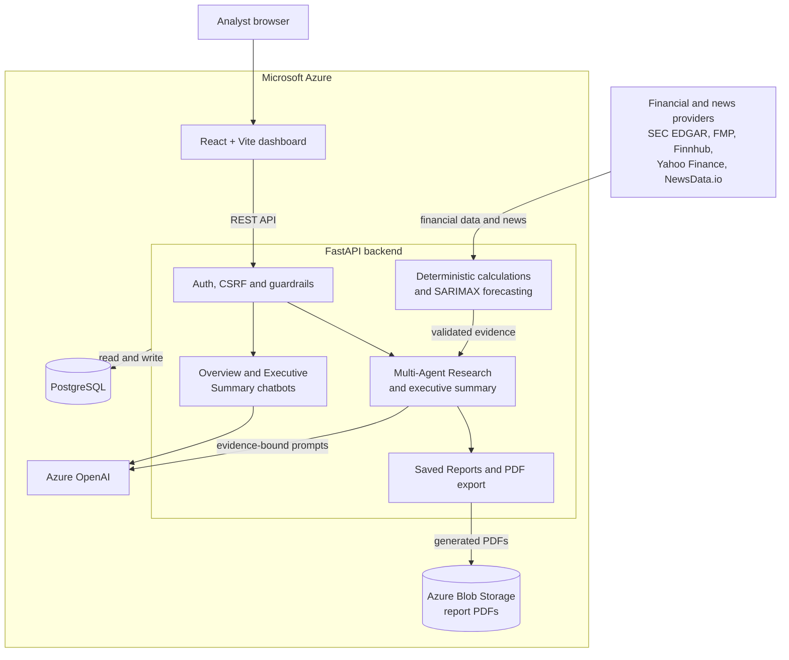

# InsightIQ — AI-Powered Multi-Agent Business Research & Growth Analyser

**InsightIQ** is an AI-powered multi-agent business research and growth analysis platform designed to deliver reliable, data-driven insights into publicly listed companies across the US and Indian markets.

The platform integrates financial data from regulatory filings, market-data providers and news sources with deterministic financial calculations and SARIMAX-based forecasting. Three specialised AI agents — Financial Analyst, News Intelligence and Strategic Analysis — work collaboratively to generate comprehensive, evidence-grounded business insights.

InsightIQ provides an interactive research dashboard, executive summaries, sector-wise company comparisons, downloadable PDF reports and context-aware AI chatbots. By combining advanced statistical modelling, multi-agent intelligence and robust AI governance and guardrails, the platform enables transparent, traceable and informed business research through a unified and intuitive experience.

> Forecasts are statistical estimates, not reported results. InsightIQ does not give investment advice.

**Status labels used in this document:** **Implemented** = in this repository's code. **Configurable** = implemented, but active only when the related environment variable is set. **Proposed** = planned improvement.

## Table of Contents

1. [Project Overview](#1-project-overview)
2. [Problem Statement and Business Objectives](#2-problem-statement-and-business-objectives)
3. [Proposed Solution](#3-proposed-solution)
4. [Target Users and User Roles](#4-target-users-and-user-roles)
5. [MVP Scope and Features](#5-mvp-scope-and-features)
6. [Functional and Non-Functional Requirements](#6-functional-and-non-functional-requirements)
7. [User Stories and Acceptance Criteria](#7-user-stories-and-acceptance-criteria)
8. [System Architecture](#8-system-architecture)
9. [Research Workflow](#9-research-workflow)
10. [Technology Stack and Design Decisions](#10-technology-stack-and-design-decisions)
11. [AI Governance, Guardrails and Security](#11-ai-governance-guardrails-and-security)
12. [Risks and Controls](#12-risks-and-controls)
13. [Repository Structure](#13-repository-structure)
14. [Prerequisites, Setup and Run Instructions](#14-prerequisites-setup-and-run-instructions)
15. [Azure Deployment](#15-azure-deployment)
16. [Current Limitations and Future Improvements](#16-current-limitations-and-future-improvements)

---

## 1. Project Overview

InsightIQ is a full-stack application with a FastAPI backend, a React (Vite) dashboard and a PostgreSQL database.

- **Research:** a LangGraph workflow runs three research agents on Azure OpenAI over a validated evidence package, and an executive-summary step follows.
- **Numbers are never AI-generated.** Ratios, growth rates, rankings and SARIMAX forecasts are computed in Python. The AI may only cite these values, and every AI output is checked against the evidence before it is shown.

## 2. Problem Statement and Business Objectives

**Problem Statement**

Business research and growth analysis require collecting, consolidating and interpreting large volumes of financial data, regulatory filings, market information and business news from multiple sources. Traditional manual research is time-consuming, resource-intensive and susceptible to inconsistencies and calculation inaccuracies.

Although conventional AI tools can accelerate research, they often lack reliable source attribution, financial accuracy, contextual understanding and effective validation mechanisms, increasing the risk of unsupported insights and misleading conclusions.

There is a need for an intelligent, unified research platform that combines reliable financial data, deterministic calculations, statistical forecasting and specialised AI agents to deliver accurate, transparent, evidence-grounded and actionable business insights.

**Business objectives**

| # | Objective | How it is measured |
|---|---|---|
| O1 | Cut the time to produce a sourced company brief | One click runs the full research workflow and saves a report |
| O2 | Make every figure traceable | Each figure cites a stored filing or provider row and its period |
| O3 | Remove AI arithmetic and hallucinated numbers | AI text whose numbers are not in the evidence is rejected or withheld |
| O4 | Cover the US and Indian markets on one platform | Both markets support search, company pages, sector comparison and AI research |
| O5 | Give an honest forward view | Forecasts are shown only with enough history and backtesting; otherwise the reason is shown |

## 3. Proposed Solution

| Step | What happens |
|---|---|
| 1. Ingest | Load SEC EDGAR facts, FMP and Finnhub data (US), Yahoo Finance data (India) and news from Finnhub and NewsData.io |
| 2. Normalise | Convert filings and provider data to fiscal quarterly and annual series |
| 3. Calculate | Compute fundamentals, growth metrics and sector rankings deterministically |
| 4. Forecast | Fit SARIMAX models against a seasonal-naive baseline, with rolling backtests |
| 5. Analyse | Run the Financial, News and Strategic agents over an evidence package |
| 6. Validate | Check numbers, periods, citations, language and company scope |
| 7. Summarise | Write the executive summary and thorough research sections |
| 8. Publish | Save the report, offer a PDF download and enable scoped chatbots |

## 4. Target Users and User Roles

**Target users**
- Business and financial analysts.
- Strategy and consulting teams.
- Students and researchers comparing listed companies and sectors.

**User roles**

| Role | Implemented as | Capabilities |
|---|---|---|
| Authenticated user | Email and password account (`users` and `sessions` tables) | Markets, company pages, research, saved reports, PDF downloads, chatbots, sector comparison |
| Operator / administrator | Procedural only: whoever has server or shell access | Creates accounts (`scripts/provision_users.py`), runs migrations and backups, monitors operations |
| Service client | `API_ACCESS_KEY` header | Server-to-server calls and automated tests |

All signed-in users share the same permissions; in-app role-based access control is a planned improvement.

**Expected business outcomes:** faster, repeatable research briefs, figures that can be audited back to source, and transparent forecasts that admit uncertainty.

## 5. MVP Scope and Features

| Feature | Status | Key code |
|---|---|---|
| US market: curated universe, search, top companies, company pages | Implemented | `market_registry.py`, `market_providers/` |
| India market: the same capabilities, through Yahoo Finance and NewsData.io | Implemented | `yfinance_client.py`, `news_ingestion.py` |
| SEC EDGAR ingestion, reconciled to 10-K filings for 44 of 47 US universe companies | Implemented | `sec_ingestion.py`, `sec_coverage.py` |
| Financial normalisation, fundamentals and growth metrics (QoQ, YoY, CAGR) | Implemented | `financial_normalization.py`, `fundamentals.py`, `growth_analysis.py` |
| SARIMAX forecasting with an eligibility check, backtesting and intervals | Implemented | `forecasting.py`, `forecast_quality.py` |
| Financial Analyst, News Intelligence and Strategic Analysis agents | Implemented | `backend/app/agents/` |
| Research jobs: background execution, deadline and cancellation | Implemented | `research_jobs.py`, `research_workflow.py` |
| Executive summary and thorough research sections | Implemented | `executive_summary.py` |
| Saved Reports, report viewer, charts, PDF download | Implemented | `report_history.py`, `company_report_pdf.py`, `SavedReportsPage.jsx` |
| Sector-wise and custom comparison with explainable ranking, PDF and DOCX | Implemented | `ranking_service.py`, `sector_report.py` |
| Overview chatbot and Executive Summary (report-scoped) chatbot | Implemented | `chatbot.py`, `ChatWidget.jsx` |
| Email and password authentication with sessions and CSRF | Implemented | `auth.py` |
| PostgreSQL persistence, 24-hour company cache, scheduled backups | Implemented | `database/`, `company_cache.py`, `backup_scheduler.py` |
| Guardrails, governance audit and narrative validation | Implemented | `guardrails.py`, `governance.py`, `narrative_validation.py` |
| Request, chat and database tracing persisted in PostgreSQL; OpenTelemetry agent-workflow tracing; centralised error log; Operations panel | Implemented | `telemetry.py`, `agent_tracing.py`, `observability.py`, `errors.py`, `OperationsPanel.jsx` |
| Azure Blob Storage for generated report PDFs | Implemented (`AZURE_STORAGE_ACCOUNT_URL`) | `report_blob.py` |
| Application Insights export through OpenTelemetry | Configurable (`APPLICATIONINSIGHTS_CONNECTION_STRING`) | `telemetry.py` |
| Groq fallback LLM | Implemented fallback (`GROQ_API_KEY`, `GROQ_MODEL`) | `ai_provider.py` |

**Out of MVP scope:** price-history charts, portfolio advice and trading signals, and in-app role management.

## 6. Functional and Non-Functional Requirements

### Functional requirements

| ID | Requirement |
|---|---|
| FR1 | Users sign in with email and password; unauthenticated API calls are rejected |
| FR2 | Users search and open US and Indian companies; stale data (older than `DATA_REFRESH_TTL_HOURS`, default 6) refreshes automatically |
| FR3 | The system stores and normalises statements by fiscal period, with the source provider and currency |
| FR4 | The system computes ratios, growth metrics and rankings deterministically |
| FR5 | The system produces SARIMAX forecasts only for eligible history, and states the reason when a forecast is unavailable |
| FR6 | A research run executes the Financial, News and Strategic agents and saves an immutable report |
| FR7 | The system generates an executive summary with evidence citations and offers the report as a PDF |
| FR8 | The Overview and Executive Summary chatbots answer only from stored data and the scoped report |
| FR9 | Users compare a whole sector or 2–6 selected companies, with a downloadable PDF or DOCX |
| FR10 | Operators can view traces, errors, governance records and reliability alerts |

### Non-functional requirements

| Area | Requirement |
|---|---|
| Accuracy | All arithmetic is in code. AI text with an unmatched number, period or citation is rejected or withheld |
| Security | Scrypt password hashes, HttpOnly session cookies, CSRF checks, rate limits, no secrets in logs, prompts or the frontend |
| Reliability | Bounded retries and backoff for LLM and provider calls, job deadlines, startup recovery of interrupted jobs |
| Performance | 24-hour company cache; repeat searches within the TTL make no provider or AI calls |
| Data integrity | Additive, idempotent migrations; report files checked by SHA-256 read-back; verified backups |
| Observability | Request, chat and database traces persisted in PostgreSQL; OpenTelemetry tracing of agent workflows; one log line per AI call with tokens and latency |
| Portability | The LLM model is chosen in `.env` (`LLM_MODEL`) with no code change |
| Testability | Offline, network-guarded test suites for the backend (pytest) and frontend (`node --test`) |

## 7. User Stories and Acceptance Criteria

| # | User story | Acceptance criteria (measurable) |
|---|---|---|
| US1 | As an analyst, I want every financial figure to come from a genuine source so I can trust it. | Every displayed figure carries its provider or SEC source, fiscal period and currency. Provider-sourced figures are labelled "not SEC-validated". Every value is re-checked against its stored row. |
| US2 | As an analyst, I want ratios and growth rates calculated correctly. | Recomputing from the stored statements gives the same value (to rounding). A zero or negative base returns "n/a" with a reason, never NaN or Infinity. Short history shows "Insufficient history (need N, have M)". |
| US3 | As an analyst, I want AI findings grounded in evidence. | Every number in AI text matches an evidence value exactly. Every finding cites a valid evidence ID. A section that fails validation is withheld and labelled; it is never shown unvalidated. |
| US4 | As an analyst, I do not want unsupported forecasts. | No forecast is produced with fewer than 20 contiguous quarters. Backtesting needs 28. Intervals are shown only when coverage gates pass. Otherwise the report states why the forecast is unavailable. |
| US5 | As an analyst, I want missing data handled honestly. | Missing values appear as "not available". A missing provider key shows "not configured" instead of an error. With no news stored, research continues on financial evidence and says so. |
| US6 | As an analyst, I want a one-page executive summary and a PDF. | The summary is 150–250 words with cited sources and an "AI-generated, not investment advice" note. The PDF downloads as `<Company>_Research_Report_<YYYY-MM-DD>.pdf`. |
| US7 | As an analyst, I want to reopen past research. | Saved Reports lists completed runs. Reopening a report makes no provider or AI calls and shows the original numbers. |
| US8 | As an analyst, I want to ask questions about a report. | The Executive Summary chat answers only within the selected report. If that report has no completed summary, the request returns HTTP 409. |
| US9 | As a security owner, I want prompt injection and data leakage blocked. | Inputs that match injection or prompt-extraction patterns are refused. Untrusted text (news, provider text) is scrubbed before it reaches the model. Outputs containing configured secrets are blocked. |
| US10 | As a security owner, I want only authenticated users to reach data. | API calls without a valid session or access key return 401. State-changing requests without a matching CSRF token are rejected. Passwords are stored only as scrypt hashes. |
| US11 | As an operator, I want failures to be visible. | Each AI call, research stage and error is recorded with a trace ID. The Operations panel lists recent errors and alerts. |

## 8. System Architecture



The financial and news providers are external services outside Azure. Observability (tracing, error logging and Application Insights export) runs across the backend and is described in [section 11](#11-ai-governance-guardrails-and-security).

**Multi-Agent Research** (LangGraph workflow in `backend/app/agents/`)

| Agent | Responsibility |
|---|---|
| Financial Analyst | Interprets normalised statements, ratios, growth and forecasts; every claim copies an evidence value exactly |
| News Intelligence | Selects company-relevant articles and summarises developments, treating news text as untrusted input |
| Strategic Analysis | Combines financial and news findings into priorities, risks and outlook; marked *unavailable* rather than invented if it fails |
| Executive summary | Writes the 150–250 word summary and research sections from the validated findings |

**Component responsibilities**

| Component | Responsibility |
|---|---|
| React + Vite dashboard | Markets, company pages, research, Saved Reports, sector comparison, chat, Operations |
| Auth, CSRF and guardrails | Session validation, CSRF, rate limits, input and output safety checks |
| Deterministic calculations and SARIMAX | Normalisation, fundamentals, growth, ranking and forecasting in Python, with no AI |
| Chatbots | Answers scoped to stored company data or to one saved report |
| Saved Reports and PDF export | Immutable reports and reportlab PDFs |
| Azure OpenAI | Primary LLM provider; Groq is the implemented fallback for authentication or deployment failures |
| PostgreSQL | Companies, facts, news, runs, reports, cache, users, sessions, chat, traces, errors, governance |
| Azure Blob Storage | Stores generated report PDFs as durable, immutable blobs, accessed with managed identity |

## 9. Research Workflow

1. **Trigger.** The user clicks **Research this company**. A background job starts with a deadline, and the user can cancel it.
2. **Evidence.** Stored filings and provider rows are refreshed if stale. They are normalised and packaged with evidence IDs (`evidence_package.py`).
3. **Calculate and forecast.** Fundamentals, growth metrics and eligible SARIMAX forecasts are computed and attached as evidence.
4. **Financial Analyst agent.** Writes claims that copy evidence values exactly. If the AI fails, a labelled deterministic fallback is used.
5. **News Intelligence agent.** Selects relevant articles (relevance-scored), then analyses them as untrusted, scrubbed input.
6. **Strategic Analysis agent.** Synthesises priorities and risks. If it fails, the section is marked *unavailable* rather than invented.
7. **Validation.** Numbers, periods, citations, causal and advisory language, and company scope are checked. Failing sections are withheld.
8. **Executive summary.** The summary and research sections are generated, validated and cached per report.
9. **Publish.** The report is saved in PostgreSQL, the PDF is rendered and stored in Azure Blob Storage, and the chatbots become available.

## 10. Technology Stack and Design Decisions

| Layer | Technology | Why |
|---|---|---|
| Frontend | React + Vite, custom SVG charts | Light SPA; charts stay consistent with server-side PDFs |
| Backend | FastAPI (Python) | Async API, Pydantic validation, Python data ecosystem |
| Orchestration | LangGraph | Explicit, testable multi-agent state graph |
| LLM | Azure OpenAI through one module (`ai_provider.py`) | Enterprise hosting; strict JSON-schema output; model switched in `.env` |
| Forecasting | statsmodels SARIMAX against a seasonal-naive baseline | Interpretable, seasonal, backtestable; the baseline guards against overfitting |
| Database | PostgreSQL (psycopg 3 and pool), versioned SQL migrations | Durable, concurrent, cloud-portable |
| Reports | reportlab (PDF), DOCX for sector reports | Deterministic server-side rendering; no browser needed |
| File storage | Azure Blob Storage (managed identity) | Immutable, durable report files without credentials in code |
| Observability | Custom tracing in PostgreSQL, OpenTelemetry SDK, Azure Monitor exporter | Queryable traces for the Operations panel, standard agent tracing, export to Application Insights |
| Packaging | Dockerfiles, docker-compose, AKS manifests | Reproducible builds and cloud deployment |

**Key decisions**
- **Deterministic arithmetic first.** The LLM never computes, ranks or changes a number.
- **Evidence is the contract.** The AI receives evidence IDs and must cite them, and validators enforce this.
- **Fail visibly.** Missing data, ineligible forecasts and failed AI sections are labelled, never filled in.
- **One AI gateway.** Model differences are adapted in one place, and a check on the served-model prefix prevents silent model substitution.

## 11. AI Governance, Guardrails and Security

| Control | Implementation |
|---|---|
| Hallucination prevention | Evidence-bound prompts. `financial_claims.py` and `narrative_validation.py` require exact numbers, valid periods and valid evidence IDs. Failing sections are withheld. |
| Deterministic arithmetic | All calculations are in `fundamentals.py`, `growth_analysis.py`, `ranking_service.py` and `forecasting.py`. |
| Prompt injection protection | `guardrails.py` detects injection, prompt extraction and role-play in inputs, and scrubs untrusted news and provider text before it reaches a model. |
| Output safety | Responses are checked for secret leakage and advisory language ("not investment advice"). Answers are refused for fabrication requests. |
| Model integrity | Strict JSON-schema output, Pydantic validation, and rejection of answers from an unexpected served model. |
| Governance audit | `governance.py` records the outcome of each AI call, with hashed evidence (no prompt text stored). |
| Observability | `telemetry.py` records request, chat and database traces in PostgreSQL. `agent_tracing.py` traces agent workflows with OpenTelemetry. `errors.py` keeps a centralised, sanitised error log. Traces are exported to Application Insights when `APPLICATIONINSIGHTS_CONNECTION_STRING` is set. |
| Authentication | Scrypt password hashes compared in constant time, random 256-bit session tokens (only the SHA-256 is stored), HttpOnly cookies, CSRF. |
| Abuse limits | Per-user rate limits (`guardrails.allow`) and ticker validation. |
| Secrets | Kept in `.env` (git-ignored) or a Kubernetes secret or Key Vault. Never logged or sent to the frontend. Downloads are served through the backend only (no SAS links). |
| Data in transit | `DB_SSLMODE=require` or stricter is required for any non-local database host. |

These checks reduce prompt-injection risk but cannot eliminate it.

## 12. Risks and Controls

| Risk | Impact | Control |
|---|---|---|
| AI hallucinated figures or claims | Misleading research | Exact-match validation, evidence IDs, sections withheld, deterministic fallbacks |
| Unreliable forecasts | False confidence | History thresholds, backtest against a baseline, interval coverage gates, explicit "unavailable" reasons |
| Provider outage, throttling or terms limits (yfinance is unofficial) | Stale or missing data | Cache, stale-data warnings, "not configured" states, FMP daily budget, quote fallback |
| Prompt injection through news or user input | Manipulated output | Input detection, scrubbing of untrusted text, output leak checks |
| Credential exposure | Account or cost abuse | Git-ignored `.env`, no secrets in logs or the frontend, managed identity for Blob |
| LLM cost overrun | Budget | Per-call output caps, bounded concurrency (`INSIGHTIQ_AZURE_MAX_CONCURRENT_CALLS`), cached summaries |
| Data loss | Lost reports and history | Scheduled `pg_dump` backups with restore verification, immutable SHA-256-verified report blobs |
| Single API replica (jobs run in-process) | Limited scale | Documented limit; an external job runner is a future improvement |

## 13. Repository Structure

| Path | Contents |
|---|---|
| `backend/app/agents` | Financial, News and Strategic agents, provider financial agent, research workflow |
| `backend/app/services` | Data ingestion, calculations, forecasting, AI provider, guardrails, chat, reports, observability |
| `backend/app/database` | Database layer and versioned PostgreSQL migrations (`migrations/0001`–`0011`) |
| `backend/app/core` | Configuration, security, market universe, ranking weights |
| `frontend/src` | React pages, components and view models |
| `tests`, `frontend/tests` | Offline backend (pytest) and frontend (`node --test`) suites; `tests/e2e` for live checks |
| `scripts` | Run, setup, migration, backup, provisioning and verification scripts |
| `deploy` | Alternative AKS manifests and secret template |
| `docs` | Azure migration report, PostgreSQL migration guide, demo runbook, validation evidence |
| `migration_reports` | Historical migration and audit records |
| `Dockerfile`, `frontend/Dockerfile`, `docker-compose.yml` | Container builds |

Detailed feature documentation: [README_INSIGHTIQ.md](README_INSIGHTIQ.md).

## 14. Prerequisites, Setup and Run Instructions

**Prerequisites**
- Python 3.13
- Node.js 20 or newer
- A PostgreSQL server (local or cloud)
- Azure OpenAI deployment credentials
- Optional provider keys: Finnhub, FMP, NewsData.io, and an SEC user agent

**Setup (Windows PowerShell)**

```powershell
# 1. Create and activate the Python virtual environment
py -3.13 -m venv .venv
.\.venv\Scripts\Activate.ps1

# 2. Install backend dependencies (pinned)
python -m pip install -r requirements.lock.txt

# 3. Install frontend dependencies (from the lockfile)
cd frontend; npm ci; cd ..

# 4. Configure the environment, then edit .env:
#    DB_*, AZURE_OPENAI_API_KEY, AZURE_OPENAI_ENDPOINT, LLM_MODEL, provider keys
if (-not (Test-Path .env)) { Copy-Item .env.example .env }

# 5. Create the PostgreSQL database and apply migrations
python scripts\setup_postgres.py

# 6. Create login accounts (hidden password prompt)
python scripts\provision_users.py you@example.com

# 7. Start the backend and dashboard
.\scripts\start_all.ps1
```

If PowerShell blocks activation, run `Set-ExecutionPolicy -Scope Process Bypass` first. `scripts\setup_remote.ps1` automates steps 1–4.

Open http://127.0.0.1:5173 and sign in. Readiness check: http://127.0.0.1:8000/health/ready.

**Run the backend and frontend separately:** `.\.venv\Scripts\python.exe scripts\run_backend.py`, then `cd frontend; npm run dev`.

**Tests:** `python -m pip install -r requirements-dev.txt`, then `python -m pytest -q` and `cd frontend; npm test`.

**Containers:** `docker compose --env-file .env up --build`, then open http://localhost:8080.

More detail: [docs/POSTGRES_MIGRATION.md](docs/POSTGRES_MIGRATION.md), [DEPLOYMENT.md](DEPLOYMENT.md) and [docs/DEMO_RUNBOOK.md](docs/DEMO_RUNBOOK.md).

## 15. Azure Deployment

InsightIQ is deployed on Microsoft Azure as a complete cloud-hosted application.

### Deployment architecture

| Component | How it runs on Azure |
|---|---|
| React dashboard and FastAPI backend | One container built from the root `Dockerfile`; FastAPI also serves the built React app |
| Database | Cloud PostgreSQL over TLS (`DB_SSLMODE=require` or `verify-full`); additive migrations run at startup |
| AI | Azure OpenAI through `AZURE_OPENAI_ENDPOINT` and `LLM_MODEL`; connectivity record in [docs/validation_evidence/azure_connectivity.json](docs/validation_evidence/azure_connectivity.json) |
| Report storage | Azure Blob Storage (`AZURE_STORAGE_ACCOUNT_URL`), accessed with managed identity (`DefaultAzureCredential`); blobs are immutable and SHA-256 verified, and downloads go only through the authenticated API |
| Observability | Traces persisted in PostgreSQL and exported through OpenTelemetry to Application Insights (`APPLICATIONINSIGHTS_CONNECTION_STRING`) |
| Backups | In-app scheduled PostgreSQL backups (`backup_scheduler.py`) |

An alternative Kubernetes (AKS) deployment path is documented in [deploy/README.md](deploy/README.md). The Azure OpenAI migration is described in [docs/AZURE_MIGRATION_REPORT.md](docs/AZURE_MIGRATION_REPORT.md).

**Independence from the local computer.** The deployed application reads and writes only cloud PostgreSQL, Azure Blob Storage and Azure OpenAI. The developer's PC, local PostgreSQL and pgAdmin are not in the request path; pgAdmin is only an optional admin client.

### Deployment, security, backup and recovery

- **Deploy:** build and push the image, set the app settings (environment variables) from secrets or Key Vault, start the app, then confirm `/health/ready`. Create accounts with `scripts/provision_users.py`.
- **Security:** keep secrets out of images and Git, use managed identity for Blob, enforce TLS to PostgreSQL, and set `TRUSTED_PROXY_IPS` behind a proxy.
- **Backup:** `backup_scheduler.py` and `scripts/backup_postgres.py` produce verified `pg_dump` backups. Report blobs are immutable.
- **Recovery:** restore the last verified dump into a new database, point `DATABASE_URL` or `DB_NAME` at it, and restart. Application rollback means redeploying the previous image, and no schema rollback is needed. See [deploy/README.md](deploy/README.md).

## 16. Current Limitations and Future Improvements

**Current limitations**
- SEC reconciliation covers 44 of 47 US universe companies; WFC, GS and XOM cannot be reconciled from their SEC data. Other companies use provider data labelled "not SEC-validated".
- India data relies on yfinance, an unofficial client that can be throttled.
- There is no price-history chart; only the latest quote is stored.
- The API runs as a single replica because research jobs run in-process.
- There is no in-app role-based access control.
- Prompt-injection defences reduce risk but cannot eliminate it.

**Future improvements**
- Add an external job runner so the API can scale horizontally.
- Add role-based access (analyst and admin) and admin UI for user management.
- Store price history and add more Indian data sources with official licences.
- Automate CI for tests and security scans.

---
